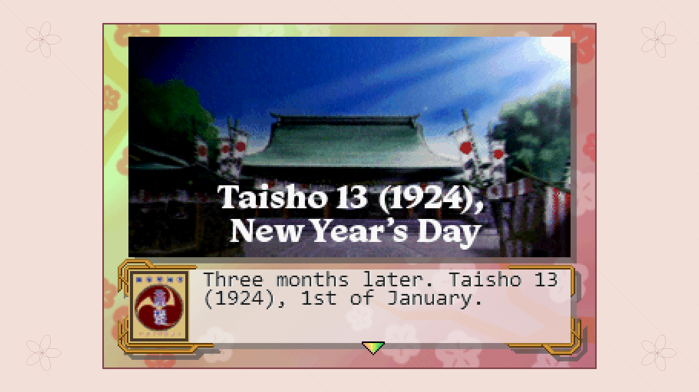

# SaturnTaisen

**Sakura Wars / Sakura Taisen · MatyMeatBoy · Windows x64 · 0.2.2-alpha**

An experimental native Windows port of Sakura Wars for Sega Saturn, with integer scaling and a themed launcher.

SaturnTaisen (formerly SaturnTaisenFirst) is an experimental Windows x64 port of the first Sakura Wars / Sakura Taisen for Sega Saturn. It uses static SH-2 recompilation with a supporting hardware runtime. The documented game-execution path is strict AOT; interpreter-only discovery and the sound/hardware runtime are separate.

v0.2.2-alpha needs only the player's own files: the two Saturn discs (original Japanese, or already patched with the English translation v2.1) and, optionally, the PC edition. The launcher prepares the game on the player's PC in English or Spanish and builds the HD pack (19 backgrounds, 302 portraits). It has a single entry point with frontend flags (--rom, --language, --no-launcher, --integration-info) described in recomp-launcher.json, integer nearest-neighbor scaling, separate save import, Original/Enhanced presentation and an in-game settings panel.

Documented tests cover extended adventure exploration, selected saves and entry into the first battle. This is not a completed port: the full campaign, all battles/minigames, complete audio fidelity, real automatic disc changes and physical controller acceptance remain open. No discs, BIOS or original game files are included; the language layers are differences that only work with the player's own discs.

## Install

[v0.2.2-alpha](https://github.com/MatyMeatBoy/SaturnTaisen/releases/tag/v0.2.2-alpha)

Your own Sakura Taisen discs 1 and 2 for Sega Saturn (Japan, GS-9037 V1.005; original or English v2.1) and, optionally, the PC edition for the HD mod.

1. Extract the complete Windows release ZIP.
2. Run SaturnTaisen.exe.
3. In "Preparar juego" choose the folder with your files (or any one of them) and press Preparar.
4. Pick the language and press Jugar. Import an existing save into a separate copy if desired.

Easy Setup / frontends: `SaturnTaisen.exe --rom "{rom}" --language es --no-launcher` (see `recomp-launcher.json`).

## Actual runtime capture

This is an unaltered development-runtime capture, not an AI-generated gameplay image. The project icon is separate from the developer's GitHub avatar.

## Credits

Maintained by MatyMeatBoy, based on satrecomp and its credited dependencies. Original Sakura Wars / Sakura Taisen by SEGA / RED. The English base is the Saturn English translation v2.1 by NoahSteam, TrekkiesUnite118 and their team (full credits in parches/CREDITOS.md). Catalog blossom icon generated with AI.

AI assistance is disclosed for code, project art and documentation. Original game imagery and trademarks belong to their respective rights holders.

## Catalog submission status

Prepared for Quiver Launcher and RecompLauncher review. **Not yet submitted**: authenticated portal access is required. This page is a reviewable draft, not a claim that either catalog accepted the project.

Public alpha v0.2.2-alpha. Do not describe the entire campaign, the full PC HD art or automatic real-disc transition as verified. Screenshot shows an actual English dialogue scene in the project runtime.

[Source repository](https://github.com/MatyMeatBoy/SaturnTaisen) · [Developer](https://github.com/MatyMeatBoy)
